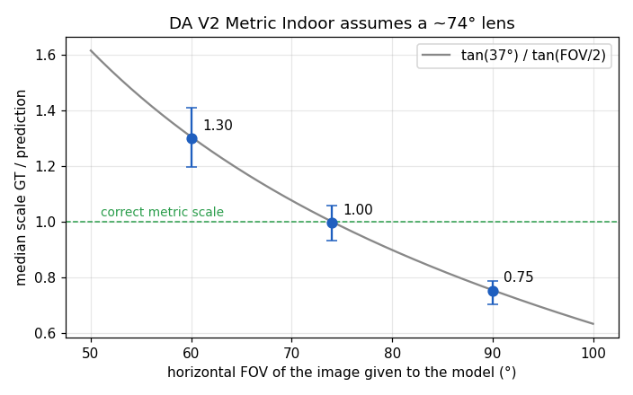
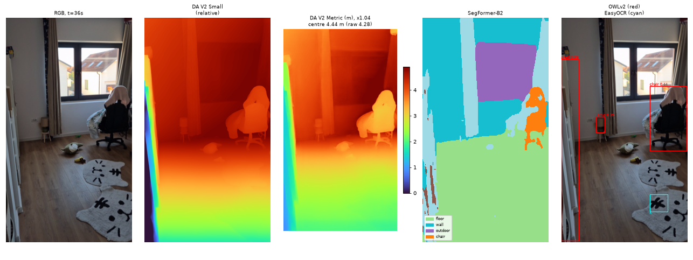
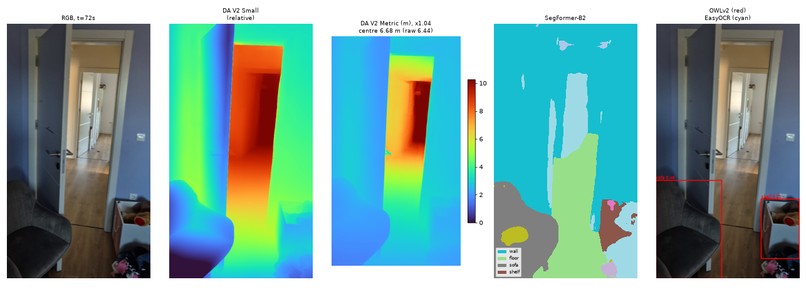
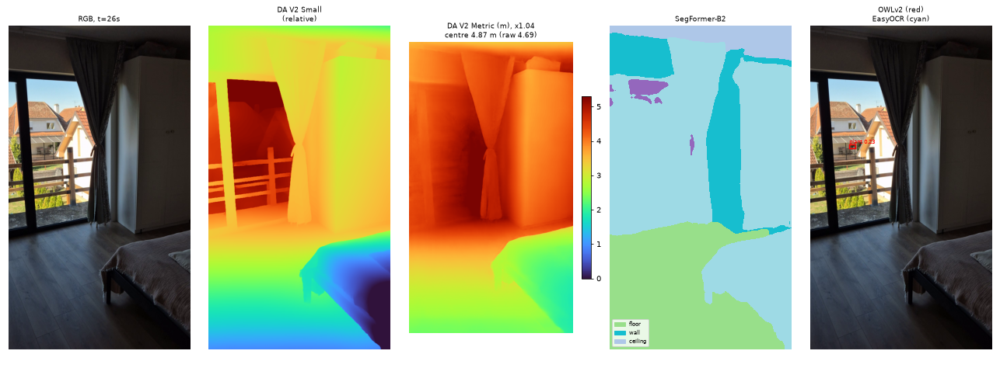
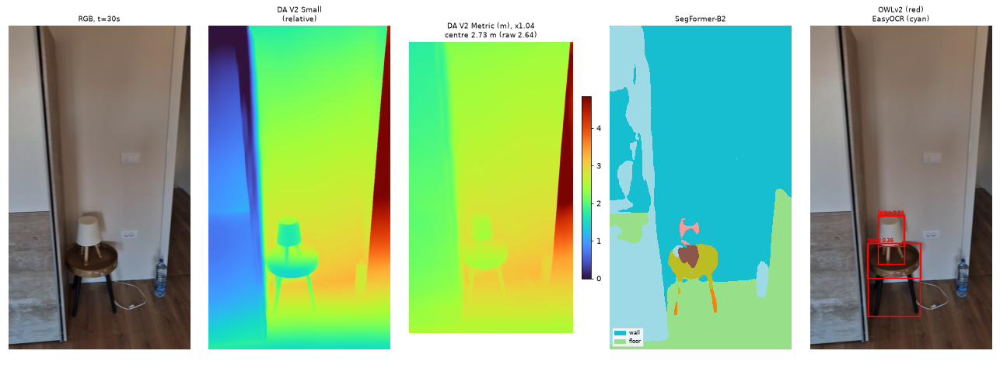
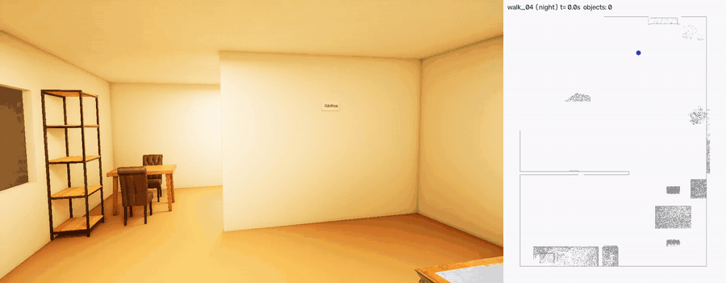

# EgoScene

Ego-centric synthetic data and scene understanding for XR glasses. **Status:** phases 1–4 complete (dataset, benchmarks, 3D scene graph); phase 5 (Gemma + panel placement) planned, see [Limitations and future work](#limitations-and-future-work).

A game engine as a ground-truth generator: UE5 renders first-person walks with perfect depth, segmentation and camera poses, which are then used to benchmark vision foundation models and build lightweight 3D scene representations.

## Key findings

Synthetic first-person walks with perfect ground truth, used to score off-the-shelf vision models the way XR glasses would use them:

1. **Metric depth is ~33 % off on a wide-angle glasses camera, and the error follows the lens.** DA V2 Metric Indoor behaves as if every image had a ~74° lens (scale error = `tan(37°)/tan(FOV/2)`, confirmed at 60°, 74° and 90°). Correcting from the camera intrinsics alone takes δ1 from 21 % to 86 %. On real phone video, structure-from-motion measured the lens (59° in video mode) so the same correction can be applied without knowing the camera in advance.
2. **Under 1 m is the blind spot across tasks.** Depth error, detection recall (53 % vs 84 % at 2–4 m) and text reading all get worse up close, exactly where you interact with things.
3. **Small things are invisible at 720p.** Detection recall is 10 % for objects under 32×32 px; signs under 20 px tall are read correctly 2.5 % of the time.
4. **Open-vocabulary detection beats closed-set segmentation for the objects XR triggers need.** Sofa: 93.7 AP with OWLv2 vs 12 IoU with SegFormer (it calls it "armchair").
5. **Lighting hurts reading most.** Day → night barely moves depth or detection, but exact text reads drop from 48 % to 28 %.
6. **A persistent 3D map needs temporally consistent depth more than accurate depth.** In the scene graph, model depth costs more than the detector (recall 61 % vs 72 %), because its scale jumps between frames and objects fragment into duplicates. Knowing the wearer's eye height pins the scale.

## Status

- [x] **Phase 1:** UE5 capture rig: glasses camera, natural head motion, GT passes, coordinate conversion. Re-projection check: 0.02 % median depth error.
- [x] **Phase 2:** dataset v1: 10 walks, 3,644 frames, 17 classes, 4 lighting presets. See the [dataset card](dataset/DATASET_CARD.md).
- [x] **Phase 3:** benchmark depth, segmentation, detection and text models against ground truth, plus a real-video check.
- [x] **Phase 4:** object-centric 3D scene graph, room layout and support relations at ~9 Hz, plus a real home video via COLMAP.
- [ ] **Phase 5 (planned):** Gemma reads the scene graph, contextual triggers and XR panel placement.

## Results: depth (Phase 3)

Every 10th frame of all 10 walks (370 frames), ground truth ≤ 10 m, RTX 3070, FP16. Full tables: [`eval/results/depth/`](eval/results/depth/).

| Model | Protocol | AbsRel ↓ | δ1 (%) ↑ | 0–1 m AbsRel ↓ | Flicker (%) ↓ | ms/frame* |
|---|---|---|---|---|---|---|
| Depth Anything V2 Small | relative, per-frame scale+shift | **0.060** | **95.7** | 0.070 | 0.69 | 32 |
| DA V2 Metric Indoor Small | raw metric | 0.428 | 21.4 | 1.164 | 1.78 | 28 |
| DA V2 Metric Indoor Small | **FOV-corrected** (intrinsics only, no GT) | 0.139 | 86.1 | 0.654 | 1.34 | 28 |
| DA V2 Metric Indoor Small | first-frame calibration | 0.203 | 61.6 | 0.401 | 1.15 | 28 |
| DA V2 Metric Indoor Small | oracle per-frame scale (upper bound) | 0.083 | 92.2 | 0.353 | 0.76 | 28 |

\* Unoptimized Hugging Face forward pass at 518×924, batch 1. My [optimized pipeline](https://github.com/karadjordjepetrovic/realtime-depth-optimization) runs DA V2 Small in 6.86 ms at 518×518; not yet re-timed at this resolution.

### Findings

**1. Metric depth fails on wide-angle glasses cameras, by a predictable amount.** On the 90° glasses frames, DA V2 Metric Indoor predicts everything about 33 % too far (median GT/pred scale 0.75; δ1 21 %). Centre-cropping the same frames to narrower fields of view shows why: the scale error follows `tan(37°) / tan(FOV/2)` almost exactly, i.e. the model behaves as if every image had a ~74° lens. Correcting for it with the camera intrinsics alone (×0.75 at 90°) lifts δ1 from 21 % to 86 % with no ground truth.



*Median GT/pred scale (bars: interquartile range across 370 frames) at 90°, 74° and 60° horizontal FOV, against the curve `tan(37°)/tan(FOV/2)`.*

**2. Calibrating on one frame is fragile; calibrating from intrinsics is not.** Estimating the scale on each walk's first frame and keeping it fixed scores worse (δ1 62 %) than the intrinsics-based correction (86 %). Three walks start next to a wall, where the first-frame scale is 0.45 instead of ~0.75, and that one bad frame skews the whole walk.

**3. Near range (0–1 m) is a separate failure.** Even with the right FOV the metric model's error under 1 m stays high (AbsRel 0.65, and 0.35 with a perfect per-frame scale), while beyond 2 m it reaches δ1 98–99.7 %. The relative model doesn't have this problem (0.070 under 1 m), so it's the metric head, not the backbone. For glasses this is the range that matters most: counters, nearby walls, hands, panels.

**4. Objects are harder than surfaces.** For DA V2 Small, sofa, table and chair have about twice the error of walls and floor (AbsRel 0.10–0.13 vs 0.06; δ1 ~81 % for sofa and table). These are exactly the surfaces XR content gets anchored to.

**5. Blank walls far away get read as "sky".** The relative model pushes 0.9 % of valid pixels to the far limit (0.4 % in daylight, 1.4 % at night), mostly plain walls seen through doorways; that's why its error beyond 4 m jumps to 0.15.

**6. Lighting matters less than expected.** Day to night changes AbsRel by 0.049 → 0.064 (relative) and 0.114 → 0.147 (metric, FOV-corrected).

| Far wall read as "sky" (DA V2 Small, night) | Near wall pushed back (DA V2 Metric, raw, evening) |
|---|---|
|  |  |

## Results: segmentation, detection, text (Phase 3)

Same 370 frames (every 10th; every 5th for text), RTX 3070, FP16, unoptimized Hugging Face forward passes. Full tables in [`eval/results/`](eval/results/).

| Task | Model | Score | ms/frame |
|---|---|---|---|
| Semantic segmentation | SegFormer-B2 (ADE20K, mapped to EgoScene classes) | 44.0 mIoU | 31 |
| Semantic segmentation | CLIPSeg (open-vocabulary prompts) | 41.5 mIoU | 80 |
| Object detection | OWLv2-base (open-vocabulary prompts) | **79.2 mAP@0.5** | 51 |
| Scene text | EasyOCR | 87 % found, **38 % read exactly** | 110 |

**Segmentation.** Large surfaces are solved (wall 93, ceiling 97, floor 88 IoU). Objects are not: SegFormer calls the sofa "armchair" (sofa 12 IoU, but 80 IoU if sofa and chair are merged into "seating"); stove 72, table 62, TV 29. Counter and sink score near zero, but they're textured blockouts in v1 and the models fairly call them "cabinet" and "step". The view through the windows is often called "painting", a synthetic artifact (a flat HDRI behind glass) that doesn't happen on the real video below. Evening is the worst split (36 vs 44–47 mIoU), partly because the evening interiors are overexposed.

**Detection.** With text prompts, OWLv2 finds chairs (96 AP), plants (96), sofas (94), shelves (88), tables and TVs (83–84). What limits it is size and range, not lighting (77–85 mAP across lighting):

| Box size | Recall | | Object distance | Recall |
|---|---|---|---|---|
| < 32² px | 10 % | | 0–1 m | 53 % |
| 32²–96² px | 56 % | | 1–2 m | 77 % |
| > 96² px | 93 % | | 2–4 m | 84 % |

**Scene text.** EasyOCR finds 87 % of the sign views but reads only 38 % exactly (character error rate 0.31). Signs under 20 px tall are almost never read (2.5 %); at night exact reads drop to 28 % (day 48 %). Up close is no better (42 %), because signs are cut off by the frame edge or seen at a steep angle.


## Sim-to-real check

The same models on a 73 s first-person phone video of a real home (Samsung S25 main camera, portrait; one frame every 2 s). No ground truth, so this is qualitative, but it checks that the synthetic findings aren't artifacts:

- **Depth scale: the lens matters on real footage too.** For this check I assumed the phone's spec FOV (~72°, factor ×1.04). Structure-from-motion later measured the actual video-mode FOV as 59° (stabilisation crops the sensor), i.e. a factor of ×1.33, and the camera-height check in Phase 4 showed the near-range bias on top of it. Absolute scale on real footage needs the lens calibration *and* a known camera height; see [Real home video](#real-home-video).
- **Real windows are recognised as windows/outdoor**, unlike the synthetic HDRI view, confirming that failure is a dataset artifact.
- **OWLv2 transfers well** (chairs, armchair, dressers as shelves). **EasyOCR hallucinates** text on a patterned rug: on real footage false positives matter too.
- Same speed as on synthetic frames: depth 19 ms, SegFormer 26 ms, OWLv2 54 ms, EasyOCR 96 ms at 720×1280.

| | |
|---|---|
|  |  |
|  |  |

## Results: 3D scene graph (Phase 4)

Per-frame perception turned into a small persistent map: the objects the glasses "know about", each with class, 3D box, top height, surface type (usable horizontal top or vertical face), what it rests on, and when it was last seen. Code in [`scene_graph/`](scene_graph/): lift each object's pixels to 3D with depth and pose, associate with existing objects (3D overlap, distance, or "partial view of a bigger object"), merge with an unbiased point reservoir, prune one-off fragments. Updated at 10 Hz along every walk; camera poses are ground truth in all variants below (no SLAM).



### Where the accuracy goes

Each row swaps one ground-truth input for a model, so the losses can be attributed (all 10 walks, 158 ground-truth objects; match = same class and 3D IoU ≥ 0.25):

| Objects from | Depth from | Recall | Precision | 3D IoU | Centroid error |
|---|---|---|---|---|---|
| ground-truth masks | ground truth | **100 %** | 99 % | 0.98 | 0.3 cm |
| ground-truth boxes → depth masks | ground truth | 93 % | 80 % | 0.54 | 11 cm |
| OWLv2 boxes → depth masks | ground truth | 72 % | 71 % | 0.54 | 13 cm |
| ground-truth masks | DA V2 Metric (FOV-corrected) | 61 % | 51 % | 0.41 | 15 cm |
| **OWLv2 boxes → depth masks** | **DA V2 Metric (FOV-corrected)** | **52 %** | **45 %** | **0.36** | **20 cm** |
| … + temporal scale alignment | | 42 % | 34 % | 0.38 | 17 cm |

**1. The graph logic is sound:** with perfect inputs it recovers every object to within 3 mm. Everything lost below that is perception, not bookkeeping.

**2. Temporally consistent depth matters more than a good detector.** Perfect masks with model depth (61 %) do worse than a real detector with perfect depth (72 %), with 81 false positives. Monocular metric depth is fairly accurate on average (δ1 86 %), but its scale jumps from frame to frame (per-frame scale 0.63–0.81 at 90° FOV), so the same table lands 30–40 cm apart in consecutive frames and fragments into duplicates. A persistent map needs depth that's consistent over time more than depth that's accurate per frame.

**3. Boxes aren't enough to lift objects to 3D.** Turning 2D boxes into masks with depth keeps recall (93 %) but halves the 3D IoU (0.98 → 0.54): the box includes the wall and floor behind thin objects. Chairs are the most-missed object. A promptable segmenter (box → mask) is the obvious next component, and a real-time trade-off to measure.

**4. A global temporal scale alignment makes it worse.** Rescaling each depth map to agree with the previous one (using the known camera motion) fixed a synthetic per-frame scale jitter in simulation (recall 31 → 77 %), but on the real model it drops recall from 52 % to 42 %. The model's error isn't one scale per frame; it's distance-dependent (near surfaces overestimated, see Phase 3), so one correction per frame smears the near-range bias over the whole image.

### Room layout

Floor plane (RANSAC on floor pixels), main walls on the top-down map (2D RANSAC lines, split at doorways), and support relations ("sink on counter", "lamp on shelf", "sign on wall"):

| Inputs | Floor height error | Floor tilt | Eye height (rig 1.60 m) | Walls found | Wall offset | Support relations agree |
|---|---|---|---|---|---|---|
| ground truth | 0.2 cm | 0.00° | 1.60 m | 100 % | 0.0 cm | – |
| DA V2 Metric + SegFormer | 11.8 cm | 1.55° | 1.59 m (**1.32–1.80** per walk) | 87 % | 7.7 cm | 75 % |

**5. Your own eye height is a free metric-scale calibration.** Walls come out well (7.7 cm), but the floor height swings by ±25 cm between walks: the per-walk scale error of monocular depth, made visible as "how tall am I". Glasses know the wearer's eye height above the floor (and gravity from the IMU), so rescaling depth until the camera sits at that height pins the metric scale with information the device already has. On the real video below, this is exactly what was needed.

### Timing (RTX 3070, FP16, 1280×720, unoptimized Hugging Face forward passes)

| Stage | ms / frame |
|---|---|
| DA V2 Metric Indoor Small (depth) | 19 |
| OWLv2-base, 11 text queries (objects) | 59 |
| SegFormer-B2 (floor / walls, layout only) | 26 |
| Scene-graph update (CPU, numpy) | 5.2 (p95 10.9) |
| **Total** | **~110 ms → ~9 Hz** |

The graph itself is cheap; the open-vocabulary detector dominates. A practical split for glasses: depth and the graph every frame, the detector at a few Hz (objects don't move often), and the optimized depth path ([6.86 ms at 518²](https://github.com/karadjordjepetrovic/realtime-depth-optimization)) instead of the stock forward pass.

### Real home video

The same pipeline on the 73 s phone walk-through, with camera poses from COLMAP (structure-from-motion) instead of ground truth ([`scene_graph/real_scene_graph.py`](scene_graph/real_scene_graph.py)); the output is a scene-graph video, a top-down map, a coloured point cloud and an Unreal import script ([`ue5/import_real_scene.py`](ue5/import_real_scene.py)). Not published, as it's a private home, but three results matter:

- **Structure-from-motion calibrates the lens for free.** COLMAP refined the focal length to a 59° field of view (I had assumed 72° from the phone's spec; video stabilisation crops the sensor), which changes the metric-depth correction from ×1.04 to ×1.33.
- **The near-range depth bias shows up on real footage too:** scaled by the depth model, the camera came out 2.2 m above the floor for a phone held at ~1.5 m; the eye-height calibration (finding 5) fixed it.
- **Offline tracking is the weak link, not perception.** Plain white walls and a hallway of identical doors split the reconstruction into chunks and mis-placed ~20 % of frames (filtered by a camera-height / walking-speed sanity check), which leaves ghosted walls and duplicate objects. Real glasses track their 6DoF pose natively; a learned SLAM (VGGT, MASt3R-SLAM) or the phone's own ARCore poses would replace this step.

## Repository

| Path | What it is |
|---|---|
| `ue5/` | Unreal Editor Python scripts: labelling, walk generation, baked lighting maps, render queue, real-scene import |
| `dataset/` | Converter (`convert_all.py`), loader (`egoscene.py`), re-projection check, demo notebook, [dataset card](dataset/DATASET_CARD.md) |
| `dataset/labels/` | Class and instance label maps |
| `eval/` | Benchmarks: `depth_benchmark.py`, `seg_benchmark.py`, `det_benchmark.py`, `text_benchmark.py`, `real_video.py`; results in `eval/results/` |
| `scene_graph/` | Scene graph (`graph.py`), layout (`layout.py`), evaluation (`eval_graph.py`, `eval_layout.py`), rendering (`render_graph.py`), real-video pipeline (`real_scene_graph.py`, `sfm.py`) |
| `placement/`, `report/` | Reserved for phase 5 and the technical report |

## Reproducing

**Environment:** Python 3.12+, an NVIDIA GPU (results above: RTX 3070 8 GB, driver 576+).

```bash
pip install numpy opencv-python OpenEXR matplotlib jupyter
pip install torch torchvision --index-url https://download.pytorch.org/whl/cu128
pip install transformers easyocr pycolmap imageio-ffmpeg
```

**1. Render the dataset (Unreal Engine 5.8, Output Log in Cmd mode)**, from the UE project with these scripts in `Scripts/`:

```
py ".../label_objects.py"            # stencil IDs + labels JSON
py ".../make_lighting_maps.py"       # day / overcast / evening / night copies of the level
py ".../make_all_walks.py"           # 10 walk sequences + manifest
py ".../make_render_queue.py"        # Movie Render Queue job per walk -> Render (Local)
```

**2. Convert and check**

```bash
python dataset/convert_all.py
python dataset/reproject_check.py data/apartment_01/walk_04 100 105      # expect < 0.1 % median error
```

**3. Benchmarks (phase 3)**

```bash
python eval/depth_benchmark.py --model da2-small --fp16
python eval/depth_benchmark.py --model da2-metric-indoor-small --fp16 [--crop-fov 74]
python eval/seg_benchmark.py --model segformer-b2-ade --fp16
python eval/seg_benchmark.py --model clipseg --fp16
python eval/det_benchmark.py --model owlv2-base --fp16
python eval/text_benchmark.py --model easyocr
python eval/real_video.py <video.mp4> --long-side-fov <deg> --fp16
```

**4. Scene graph (phase 4)**

```bash
python scene_graph/eval_graph.py --input gt              # pipeline check
python scene_graph/eval_graph.py --input gtbox
python scene_graph/eval_graph.py --input model --fp16    # all model variants + comparison.md
python scene_graph/eval_layout.py --input model --fp16
python scene_graph/render_graph.py walk_04               # video + map
python scene_graph/real_scene_graph.py <video.mp4> --long-side-fov <deg> --fp16 --camera-height 1.5
```

Every script has a debug mode that needs no GPU (`--model gt-noise`, `gt-jitter`, `gt-oracle`, `--input gt`), used to check the metric code against known answers.

## Limitations and future work

**Dataset (v1).** One environment; counter and sink are blockouts; door and window have no labelled pixels; evening interiors are overexposed; no people, sensor noise or motion blur. v2: more environments (office, street), real assets for the kitchen, a noise/blur/rolling-shutter variant, people.

**Perception → 3D.**
- Boxes lose most of an object's 3D extent (IoU 0.98 → 0.54): add a promptable segmenter (box → mask) and measure its cost per frame.
- Monocular depth errors are distance-dependent, so a global per-frame scale fix fails: try scale-and-shift alignment, fusion with SLAM points, or eye-height anchoring per frame.
- Real-time budget: run the optimized depth path and the detector at a lower rate than depth + graph.

**Real video.** Offline tracking is the weak link (plain walls, repeated doors). Next steps: a better capture (landscape, slow, a closing loop), a learned reconstruction model (VGGT, MASt3R-SLAM), or the phone's own ARCore poses, which is what glasses provide natively.

**Phase 5 (planned).** Serialize the scene graph to compact JSON and let a small Gemma model decide *when* to show something (contextual triggers, e.g. "standing at the stove → recipe") and *where* a panel goes ("pin the timer next to the stove"), with placement rules from UI practice (1–2 m away, on or near a surface, facing the user, not covering people or key objects). Evaluate on 30–50 scripted requests against ground-truth and model-built graphs.

**Also interesting:** 3D Gaussian splatting on EgoScene walks with exact poses and ground-truth depth, to measure reconstruction geometry rather than only image quality.

## Credits

Assets: [Poly Haven](https://polyhaven.com) (CC0 models, textures and HDRIs). Models: Depth Anything V2, SegFormer, CLIPSeg, OWLv2, EasyOCR; reconstruction with COLMAP. Rendered with Unreal Engine 5. Dataset licence and details in the [dataset card](dataset/DATASET_CARD.md).
