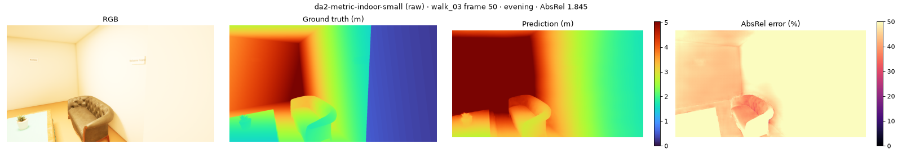
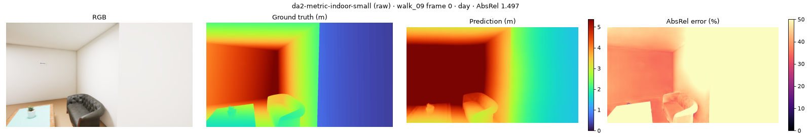
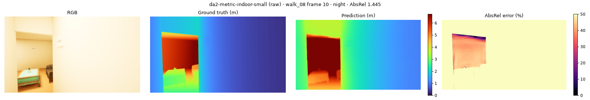
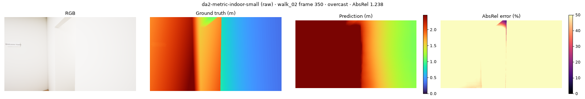

# Depth benchmark: `da2-metric-indoor-small`

depth-anything/Depth-Anything-V2-Metric-Indoor-Small-hf · metric · FP16 on cuda · every 10th frame · GT ≤ 10 m · full 90° HFOV

**Speed:** 28.27 ms/frame median, 109.40 ms p95 (model forward at (518, 924), batch 1)

## raw

Median scale error GT/pred: **0.75** (1.0 = correct metric scale; < 1 means the model predicts too far)

| Split | AbsRel ↓ | RMSE (m) ↓ | δ1 (%) ↑ | Flicker (%) ↓ | Far-clipped px (%) | Frames |
|---|---|---|---|---|---|---|
| **all** | 0.428 | 0.944 | 21.4 | 1.78 | 0.1 | 370 |
| day | 0.387 | 0.858 | 25.2 | 2.06 | 0.0 | 97 |
| overcast | 0.458 | 0.991 | 18.4 | 1.72 | 0.2 | 122 |
| evening | 0.419 | 0.915 | 26.7 | 2.24 | 0.1 | 72 |
| night | 0.440 | 1.004 | 16.5 | 1.48 | 0.1 | 79 |

| Distance | AbsRel ↓ | δ1 (%) ↑ |
|---|---|---|
| 0-1 m | 1.164 | 4.0 |
| 1-2 m | 0.496 | 11.3 |
| 2-4 m | 0.321 | 26.3 |
| >4 m | 0.301 | 30.4 |

| Class | AbsRel ↓ | δ1 (%) ↑ | Pixels |
|---|---|---|---|
| sign | 0.812 | 6.2 | 589,190 |
| wall | 0.464 | 20.7 | 231,549,449 |
| lamp | 0.407 | 4.6 | 109,652 |
| table | 0.398 | 21.8 | 5,549,213 |
| shelf | 0.384 | 18.4 | 18,677,638 |
| sink | 0.380 | 21.1 | 250,891 |
| ceiling | 0.354 | 12.5 | 22,243,610 |
| sofa | 0.353 | 15.0 | 3,782,459 |
| counter | 0.340 | 30.2 | 4,352,361 |
| tv | 0.310 | 21.2 | 1,471,345 |
| plant | 0.307 | 36.1 | 3,976,451 |
| stove | 0.306 | 27.3 | 2,416,799 |
| chair | 0.294 | 38.8 | 2,638,844 |
| floor | 0.292 | 28.5 | 30,369,412 |

## fov_corrected

| Split | AbsRel ↓ | RMSE (m) ↓ | δ1 (%) ↑ | Flicker (%) ↓ | Far-clipped px (%) | Frames |
|---|---|---|---|---|---|---|
| **all** | 0.139 | 0.271 | 86.1 | 1.34 | 0.0 | 370 |
| day | 0.114 | 0.241 | 89.4 | 1.55 | 0.0 | 97 |
| overcast | 0.150 | 0.288 | 84.0 | 1.30 | 0.0 | 122 |
| evening | 0.147 | 0.281 | 86.4 | 1.69 | 0.0 | 72 |
| night | 0.147 | 0.274 | 84.9 | 1.11 | 0.0 | 79 |

| Distance | AbsRel ↓ | δ1 (%) ↑ |
|---|---|---|
| 0-1 m | 0.654 | 22.5 |
| 1-2 m | 0.178 | 73.6 |
| 2-4 m | 0.066 | 98.4 |
| >4 m | 0.056 | 99.7 |

| Class | AbsRel ↓ | δ1 (%) ↑ | Pixels |
|---|---|---|---|
| sign | 0.382 | 55.8 | 589,190 |
| wall | 0.166 | 81.7 | 231,549,449 |
| table | 0.111 | 91.8 | 5,549,213 |
| shelf | 0.093 | 95.6 | 18,677,638 |
| sink | 0.086 | 97.6 | 250,891 |
| plant | 0.085 | 93.6 | 3,976,451 |
| lamp | 0.077 | 97.7 | 109,652 |
| counter | 0.076 | 95.5 | 4,352,361 |
| chair | 0.075 | 95.7 | 2,638,844 |
| sofa | 0.062 | 99.3 | 3,782,459 |
| ceiling | 0.056 | 99.6 | 22,243,610 |
| stove | 0.053 | 99.7 | 2,416,799 |
| floor | 0.050 | 99.7 | 30,369,412 |
| tv | 0.049 | 99.4 | 1,471,345 |

## calibrated

| Split | AbsRel ↓ | RMSE (m) ↓ | δ1 (%) ↑ | Flicker (%) ↓ | Far-clipped px (%) | Frames |
|---|---|---|---|---|---|---|
| **all** | 0.203 | 0.552 | 61.6 | 1.15 | 0.0 | 370 |
| day | 0.128 | 0.315 | 83.3 | 1.41 | 0.0 | 97 |
| overcast | 0.221 | 0.579 | 58.0 | 1.04 | 0.0 | 122 |
| evening | 0.229 | 0.656 | 53.5 | 1.28 | 0.0 | 72 |
| night | 0.246 | 0.704 | 47.7 | 0.82 | 0.0 | 79 |

| Distance | AbsRel ↓ | δ1 (%) ↑ |
|---|---|---|
| 0-1 m | 0.401 | 45.4 |
| 1-2 m | 0.206 | 59.4 |
| 2-4 m | 0.173 | 66.7 |
| >4 m | 0.213 | 54.7 |

| Class | AbsRel ↓ | δ1 (%) ↑ | Pixels |
|---|---|---|---|
| wall | 0.212 | 61.0 | 231,549,449 |
| floor | 0.195 | 61.1 | 30,369,412 |
| counter | 0.194 | 64.7 | 4,352,361 |
| sign | 0.192 | 60.4 | 589,190 |
| plant | 0.191 | 62.2 | 3,976,451 |
| tv | 0.190 | 62.1 | 1,471,345 |
| table | 0.187 | 57.4 | 5,549,213 |
| chair | 0.184 | 67.3 | 2,638,844 |
| sofa | 0.180 | 60.5 | 3,782,459 |
| stove | 0.179 | 67.4 | 2,416,799 |
| ceiling | 0.170 | 64.3 | 22,243,610 |
| shelf | 0.157 | 70.9 | 18,677,638 |
| lamp | 0.152 | 69.7 | 109,652 |
| sink | 0.150 | 75.2 | 250,891 |

## scaled

| Split | AbsRel ↓ | RMSE (m) ↓ | δ1 (%) ↑ | Flicker (%) ↓ | Far-clipped px (%) | Frames |
|---|---|---|---|---|---|---|
| **all** | 0.083 | 0.201 | 92.2 | 0.76 | 0.0 | 370 |
| day | 0.073 | 0.166 | 94.1 | 0.79 | 0.0 | 97 |
| overcast | 0.082 | 0.188 | 91.8 | 0.78 | 0.0 | 122 |
| evening | 0.092 | 0.217 | 91.6 | 0.77 | 0.0 | 72 |
| night | 0.088 | 0.248 | 91.2 | 0.64 | 0.0 | 79 |

| Distance | AbsRel ↓ | δ1 (%) ↑ |
|---|---|---|
| 0-1 m | 0.353 | 48.3 |
| 1-2 m | 0.111 | 88.1 |
| 2-4 m | 0.040 | 99.0 |
| >4 m | 0.053 | 97.0 |

| Class | AbsRel ↓ | δ1 (%) ↑ | Pixels |
|---|---|---|---|
| sign | 0.102 | 90.0 | 589,190 |
| wall | 0.097 | 90.1 | 231,549,449 |
| sofa | 0.089 | 93.3 | 3,782,459 |
| lamp | 0.082 | 94.4 | 109,652 |
| table | 0.079 | 92.7 | 5,549,213 |
| shelf | 0.074 | 94.3 | 18,677,638 |
| chair | 0.071 | 95.7 | 2,638,844 |
| plant | 0.065 | 96.3 | 3,976,451 |
| sink | 0.049 | 98.9 | 250,891 |
| tv | 0.048 | 99.6 | 1,471,345 |
| stove | 0.047 | 99.7 | 2,416,799 |
| ceiling | 0.042 | 98.8 | 22,243,610 |
| floor | 0.036 | 98.5 | 30,369,412 |
| counter | 0.034 | 100.0 | 4,352,361 |

## Worst frames

