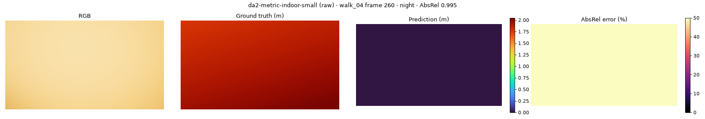
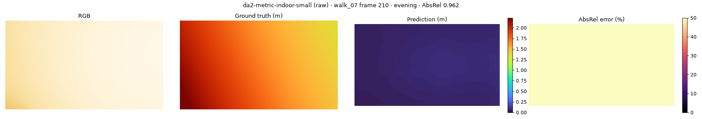
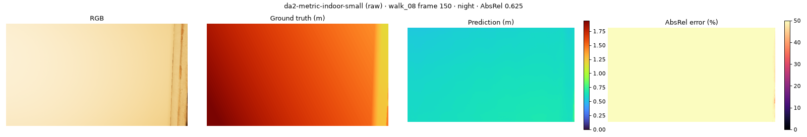
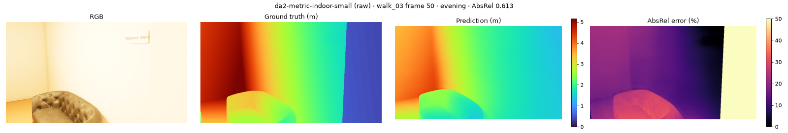

# Depth benchmark: `da2-metric-indoor-small`

depth-anything/Depth-Anything-V2-Metric-Indoor-Small-hf · metric · FP16 on cuda · every 10th frame · GT ≤ 10 m · centre-cropped to 60° HFOV

**Speed:** 33.09 ms/frame median, 45.19 ms p95 (model forward at (518, 924), batch 1)

## raw

Median scale error GT/pred: **nan** (1.0 = correct metric scale; < 1 means the model predicts too far)

| Split | AbsRel ↓ | RMSE (m) ↓ | δ1 (%) ↑ | Flicker (%) ↓ | Far-clipped px (%) | Frames |
|---|---|---|---|---|---|---|
| **all** | 0.275 | 0.818 | 34.6 | 1.48 | nan | 370 |
| day | 0.293 | 0.823 | 28.5 | 1.65 | nan | 97 |
| overcast | 0.242 | 0.733 | 43.7 | 1.36 | 0.0 | 122 |
| evening | 0.286 | 0.853 | 28.0 | 1.85 | 0.0 | 72 |
| night | 0.295 | 0.913 | 34.1 | 1.26 | nan | 79 |

| Distance | AbsRel ↓ | δ1 (%) ↑ |
|---|---|---|
| 0-1 m | 0.502 | 39.8 |
| 1-2 m | 0.309 | 41.8 |
| 2-4 m | 0.269 | 33.4 |
| >4 m | 0.224 | 29.6 |

| Class | AbsRel ↓ | δ1 (%) ↑ | Pixels |
|---|---|---|---|
| wall | 0.285 | 35.3 | 88,551,959 |
| plant | 0.280 | 17.6 | 1,212,235 |
| chair | 0.269 | 17.4 | 1,056,096 |
| stove | 0.259 | 20.3 | 649,914 |
| table | 0.253 | 27.3 | 1,415,854 |
| tv | 0.252 | 24.8 | 383,118 |
| sofa | 0.246 | 26.5 | 1,194,005 |
| floor | 0.241 | 14.7 | 4,414,864 |
| counter | 0.230 | 26.4 | 1,605,807 |
| lamp | 0.230 | 28.7 | 5,823 |
| sign | 0.229 | 40.2 | 223,480 |
| shelf | 0.212 | 47.6 | 6,093,479 |
| ceiling | 0.205 | 46.1 | 839,855 |
| sink | 0.198 | 60.1 | 108,034 |

## calibrated

| Split | AbsRel ↓ | RMSE (m) ↓ | δ1 (%) ↑ | Flicker (%) ↓ | Far-clipped px (%) | Frames |
|---|---|---|---|---|---|---|
| **all** | 0.237 | 0.674 | 58.5 | 1.76 | nan | 370 |
| day | 0.226 | 0.602 | 61.7 | 1.97 | nan | 97 |
| overcast | 0.193 | 0.486 | 72.5 | 1.75 | 0.0 | 122 |
| evening | 0.235 | 0.680 | 51.1 | 2.13 | 0.0 | 72 |
| night | 0.324 | 1.051 | 39.5 | 1.37 | nan | 79 |

| Distance | AbsRel ↓ | δ1 (%) ↑ |
|---|---|---|
| 0-1 m | 0.646 | 32.0 |
| 1-2 m | 0.329 | 49.0 |
| 2-4 m | 0.204 | 60.0 |
| >4 m | 0.167 | 67.7 |

| Class | AbsRel ↓ | δ1 (%) ↑ | Pixels |
|---|---|---|---|
| wall | 0.247 | 57.7 | 88,551,959 |
| shelf | 0.240 | 60.6 | 6,093,479 |
| stove | 0.224 | 38.0 | 649,914 |
| counter | 0.218 | 42.2 | 1,605,807 |
| sink | 0.211 | 57.1 | 108,034 |
| plant | 0.193 | 59.6 | 1,212,235 |
| ceiling | 0.185 | 57.4 | 839,855 |
| tv | 0.180 | 64.2 | 383,118 |
| floor | 0.173 | 66.0 | 4,414,864 |
| chair | 0.161 | 68.2 | 1,056,096 |
| sofa | 0.148 | 76.5 | 1,194,005 |
| table | 0.144 | 74.3 | 1,415,854 |
| lamp | 0.136 | 82.7 | 5,823 |
| sign | 0.124 | 81.5 | 223,480 |

## scaled

| Split | AbsRel ↓ | RMSE (m) ↓ | δ1 (%) ↑ | Flicker (%) ↓ | Far-clipped px (%) | Frames |
|---|---|---|---|---|---|---|
| **all** | 0.094 | 0.277 | 91.1 | 0.90 | nan | 370 |
| day | 0.094 | 0.288 | 90.1 | 1.09 | nan | 97 |
| overcast | 0.098 | 0.238 | 91.9 | 0.80 | 0.0 | 122 |
| evening | 0.093 | 0.270 | 90.8 | 0.97 | 0.0 | 72 |
| night | 0.087 | 0.333 | 91.3 | 0.75 | nan | 79 |

| Distance | AbsRel ↓ | δ1 (%) ↑ |
|---|---|---|
| 0-1 m | 0.608 | 48.3 |
| 1-2 m | 0.139 | 82.0 |
| 2-4 m | 0.063 | 94.8 |
| >4 m | 0.045 | 97.0 |

| Class | AbsRel ↓ | δ1 (%) ↑ | Pixels |
|---|---|---|---|
| table | 0.126 | 78.5 | 1,415,854 |
| sofa | 0.123 | 88.1 | 1,194,005 |
| wall | 0.101 | 90.2 | 88,551,959 |
| chair | 0.094 | 92.0 | 1,056,096 |
| plant | 0.078 | 91.9 | 1,212,235 |
| sign | 0.074 | 93.2 | 223,480 |
| ceiling | 0.073 | 92.3 | 839,855 |
| lamp | 0.073 | 87.8 | 5,823 |
| shelf | 0.071 | 94.7 | 6,093,479 |
| stove | 0.069 | 95.5 | 649,914 |
| tv | 0.041 | 99.4 | 383,118 |
| sink | 0.035 | 99.9 | 108,034 |
| floor | 0.033 | 99.1 | 4,414,864 |
| counter | 0.033 | 99.3 | 1,605,807 |

## Worst frames

