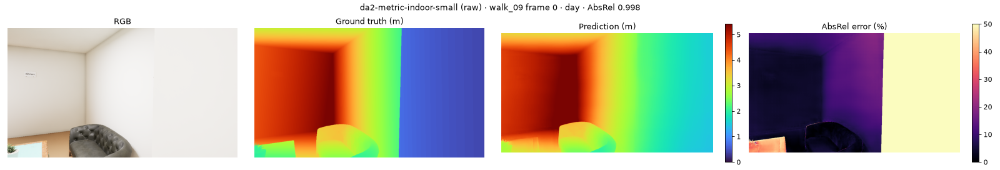
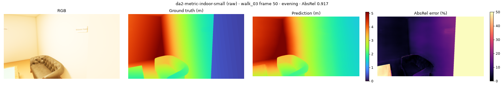
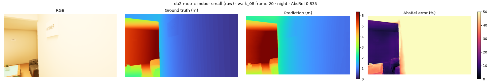
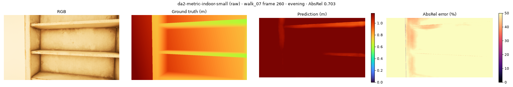

# Depth benchmark: `da2-metric-indoor-small`

depth-anything/Depth-Anything-V2-Metric-Indoor-Small-hf · metric · FP16 on cuda · every 10th frame · GT ≤ 10 m · centre-cropped to 74° HFOV

**Speed:** 30.88 ms/frame median, 85.62 ms p95 (model forward at (518, 924), batch 1)

## raw

Median scale error GT/pred: **1.00** (1.0 = correct metric scale; < 1 means the model predicts too far)

| Split | AbsRel ↓ | RMSE (m) ↓ | δ1 (%) ↑ | Flicker (%) ↓ | Far-clipped px (%) | Frames |
|---|---|---|---|---|---|---|
| **all** | 0.145 | 0.321 | 83.8 | 1.48 | 0.0 | 370 |
| day | 0.138 | 0.317 | 84.5 | 1.67 | 0.0 | 97 |
| overcast | 0.147 | 0.320 | 85.0 | 1.37 | 0.0 | 122 |
| evening | 0.152 | 0.320 | 82.9 | 1.52 | 0.0 | 72 |
| night | 0.145 | 0.326 | 82.1 | 1.58 | 0.0 | 79 |

| Distance | AbsRel ↓ | δ1 (%) ↑ |
|---|---|---|
| 0-1 m | 0.736 | 21.4 |
| 1-2 m | 0.209 | 67.1 |
| 2-4 m | 0.088 | 92.9 |
| >4 m | 0.050 | 99.8 |

| Class | AbsRel ↓ | δ1 (%) ↑ | Pixels |
|---|---|---|---|
| sign | 0.253 | 66.5 | 375,452 |
| wall | 0.161 | 81.1 | 142,998,694 |
| shelf | 0.115 | 93.0 | 10,951,410 |
| lamp | 0.106 | 95.3 | 31,969 |
| sink | 0.097 | 97.7 | 156,374 |
| table | 0.094 | 94.4 | 2,791,101 |
| plant | 0.089 | 91.3 | 2,234,095 |
| chair | 0.076 | 97.0 | 1,675,773 |
| counter | 0.075 | 96.7 | 2,592,145 |
| stove | 0.067 | 96.9 | 1,340,533 |
| sofa | 0.057 | 98.6 | 2,141,724 |
| ceiling | 0.052 | 99.9 | 5,255,224 |
| tv | 0.052 | 98.5 | 780,705 |
| floor | 0.044 | 99.8 | 11,725,542 |

## calibrated

| Split | AbsRel ↓ | RMSE (m) ↓ | δ1 (%) ↑ | Flicker (%) ↓ | Far-clipped px (%) | Frames |
|---|---|---|---|---|---|---|
| **all** | 0.182 | 0.490 | 67.6 | 1.36 | 0.0 | 370 |
| day | 0.146 | 0.370 | 82.2 | 1.63 | 0.0 | 97 |
| overcast | 0.163 | 0.372 | 79.1 | 1.34 | 0.0 | 122 |
| evening | 0.217 | 0.618 | 49.3 | 1.21 | 0.0 | 72 |
| night | 0.225 | 0.704 | 48.7 | 1.33 | 0.0 | 79 |

| Distance | AbsRel ↓ | δ1 (%) ↑ |
|---|---|---|
| 0-1 m | 0.552 | 30.0 |
| 1-2 m | 0.222 | 59.2 |
| 2-4 m | 0.145 | 73.6 |
| >4 m | 0.140 | 71.5 |

| Class | AbsRel ↓ | δ1 (%) ↑ | Pixels |
|---|---|---|---|
| wall | 0.193 | 65.8 | 142,998,694 |
| counter | 0.184 | 59.7 | 2,592,145 |
| stove | 0.179 | 64.2 | 1,340,533 |
| sign | 0.156 | 70.5 | 375,452 |
| plant | 0.156 | 70.6 | 2,234,095 |
| shelf | 0.153 | 77.0 | 10,951,410 |
| chair | 0.144 | 73.6 | 1,675,773 |
| sink | 0.143 | 65.9 | 156,374 |
| floor | 0.142 | 73.3 | 11,725,542 |
| tv | 0.134 | 75.9 | 780,705 |
| ceiling | 0.127 | 72.9 | 5,255,224 |
| table | 0.125 | 83.2 | 2,791,101 |
| lamp | 0.121 | 89.4 | 31,969 |
| sofa | 0.120 | 85.1 | 2,141,724 |

## scaled

| Split | AbsRel ↓ | RMSE (m) ↓ | δ1 (%) ↑ | Flicker (%) ↓ | Far-clipped px (%) | Frames |
|---|---|---|---|---|---|---|
| **all** | 0.079 | 0.216 | 92.7 | 0.72 | 0.0 | 370 |
| day | 0.076 | 0.202 | 92.8 | 0.84 | 0.0 | 97 |
| overcast | 0.077 | 0.191 | 92.8 | 0.71 | 0.0 | 122 |
| evening | 0.088 | 0.221 | 93.0 | 0.61 | 0.0 | 72 |
| night | 0.076 | 0.264 | 91.9 | 0.71 | 0.0 | 79 |

| Distance | AbsRel ↓ | δ1 (%) ↑ |
|---|---|---|
| 0-1 m | 0.435 | 50.4 |
| 1-2 m | 0.110 | 87.4 |
| 2-4 m | 0.047 | 97.0 |
| >4 m | 0.041 | 97.8 |

| Class | AbsRel ↓ | δ1 (%) ↑ | Pixels |
|---|---|---|---|
| lamp | 0.106 | 84.7 | 31,969 |
| sign | 0.094 | 86.0 | 375,452 |
| table | 0.090 | 92.5 | 2,791,101 |
| wall | 0.088 | 91.1 | 142,998,694 |
| sofa | 0.087 | 96.3 | 2,141,724 |
| chair | 0.072 | 96.1 | 1,675,773 |
| shelf | 0.060 | 97.5 | 10,951,410 |
| plant | 0.060 | 96.2 | 2,234,095 |
| ceiling | 0.051 | 97.2 | 5,255,224 |
| stove | 0.046 | 98.9 | 1,340,533 |
| tv | 0.043 | 100.0 | 780,705 |
| sink | 0.043 | 100.0 | 156,374 |
| counter | 0.031 | 99.7 | 2,592,145 |
| floor | 0.030 | 99.0 | 11,725,542 |

## Worst frames

