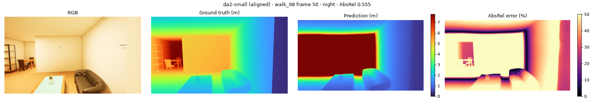
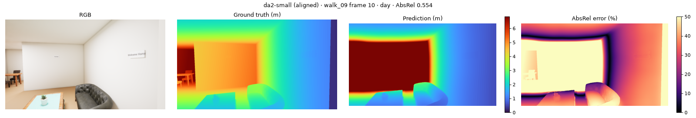
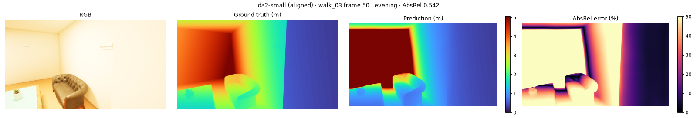
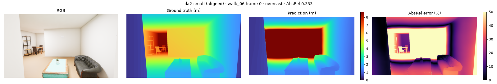

# Depth benchmark: `da2-small`

depth-anything/Depth-Anything-V2-Small-hf · relative · FP16 on cuda · every 10th frame · GT ≤ 10 m

**Speed:** 32.43 ms/frame median, 83.89 ms p95 (model forward at (518, 924), batch 1)

## aligned

| Split | AbsRel ↓ | RMSE (m) ↓ | δ1 (%) ↑ | Flicker (%) ↓ | Far-clipped px (%) | Frames |
|---|---|---|---|---|---|---|
| **all** | 0.060 | 0.283 | 95.7 | 0.69 | 0.9 | 370 |
| day | 0.049 | 0.209 | 97.6 | 0.72 | 0.4 | 97 |
| overcast | 0.068 | 0.310 | 94.6 | 0.69 | 0.8 | 122 |
| evening | 0.059 | 0.281 | 95.8 | 0.71 | 1.1 | 72 |
| night | 0.064 | 0.334 | 95.0 | 0.64 | 1.4 | 79 |

| Distance | AbsRel ↓ | δ1 (%) ↑ |
|---|---|---|
| 0-1 m | 0.070 | 95.0 |
| 1-2 m | 0.053 | 96.8 |
| 2-4 m | 0.046 | 97.6 |
| >4 m | 0.152 | 82.9 |

| Class | AbsRel ↓ | δ1 (%) ↑ | Pixels |
|---|---|---|---|
| sofa | 0.126 | 80.6 | 3,782,459 |
| table | 0.117 | 81.1 | 5,549,213 |
| sign | 0.097 | 93.9 | 589,190 |
| chair | 0.095 | 91.7 | 2,638,844 |
| plant | 0.077 | 95.5 | 3,976,451 |
| wall | 0.060 | 95.8 | 231,549,449 |
| floor | 0.060 | 96.0 | 30,369,412 |
| ceiling | 0.058 | 95.8 | 22,243,610 |
| lamp | 0.058 | 98.7 | 109,652 |
| counter | 0.051 | 98.8 | 4,352,361 |
| shelf | 0.049 | 98.7 | 18,677,638 |
| sink | 0.040 | 99.3 | 250,891 |
| stove | 0.037 | 99.6 | 2,416,799 |
| tv | 0.037 | 99.3 | 1,471,345 |

## Worst frames

