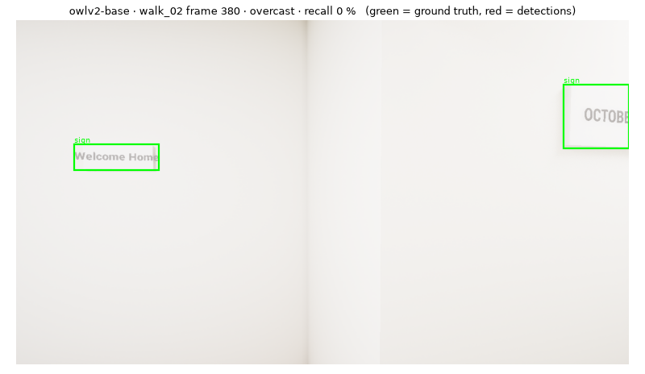
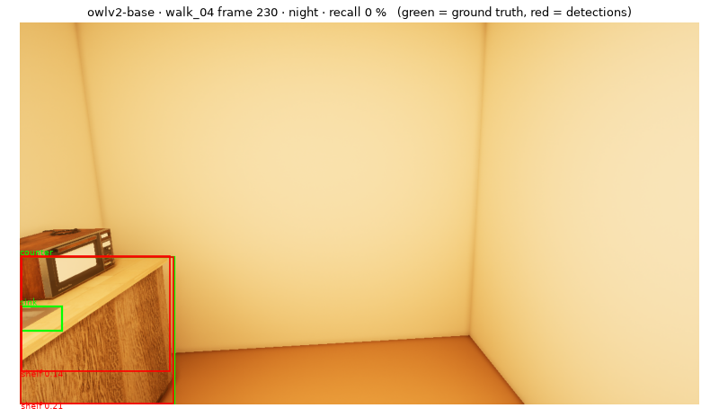
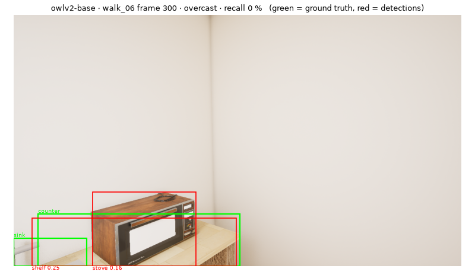
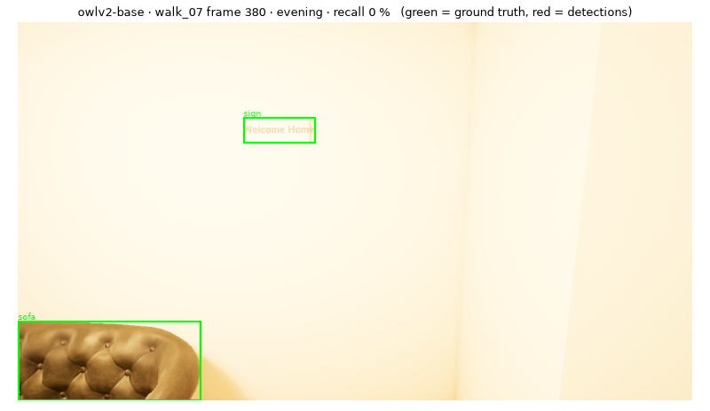

# Detection benchmark: `owlv2-base`

google/owlv2-base-patch16-ensemble · FP16 on cuda · every 10th frame · GT boxes from instance masks, ignored if < 12 px · recall at score ≥ 0.1

**Speed:** 51.25 ms/frame median, 56.93 ms p95 (model forward at (960, 960), 11 text queries)

**mAP@0.5: 79.2**

| Lighting | mAP@0.5 (%) |
|---|---|
| day | 80.3 |
| overcast | 85.3 |
| evening | 77.0 |
| night | 78.3 |

| Class | AP@0.5 (%) ↑ | GT boxes | Prompt |
|---|---|---|---|
| sink (blockout asset) | 27.5 | 54 | "a sink" |
| counter (blockout asset) | 66.1 | 83 | "a kitchen counter" |
| sign | 75.5 | 167 | "a sign with text" |
| stove | 80.0 | 89 | "a stove" |
| lamp | 81.6 | 58 | "a lamp" |
| tv | 83.4 | 110 | "a television" |
| table | 83.5 | 234 | "a table" |
| shelf | 87.8 | 240 | "a shelf" |
| sofa | 93.7 | 92 | "a sofa" |
| plant | 95.9 | 295 | "a potted plant" |
| chair | 96.0 | 268 | "a chair" |

| Object distance | Recall (%) |
|---|---|
| 0-1 m | 52.9 |
| 1-2 m | 76.8 |
| 2-4 m | 84.2 |
| >4 m | 81.1 |

| Box size | Recall (%) |
|---|---|
| small <32² | 10.2 |
| medium <96² | 55.5 |
| large | 92.8 |

## Worst frames

