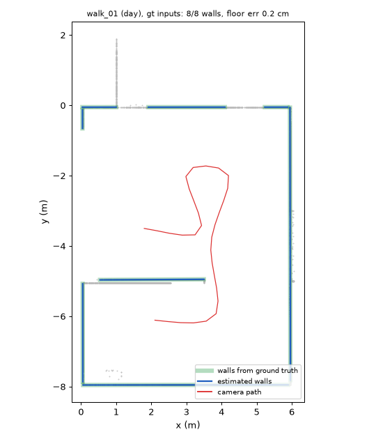

# Room layout vs ground truth: `gt` inputs

**Floor height error 0.2 cm · tilt 0.01° · eye height 1.60 m (rig: 1.60) · walls found 100 % · wall angle error 0.0° · wall offset 0.0 cm**

| Walk | Lighting | Floor err (cm) | Tilt (°) | Eye height (m) | Walls found | Wall offset (cm) |
|---|---|---|---|---|---|---|
| walk_01 | day | 0.2 | 0.00 | 1.60 | 8/8 | 0.0 |
| walk_02 | overcast | 0.2 | 0.01 | 1.60 | 6/6 | 0.0 |
| walk_03 | evening | 0.2 | 0.00 | 1.60 | 4/4 | 0.0 |
| walk_04 | night | 0.2 | 0.01 | 1.60 | 5/5 | 0.0 |
| walk_05 | day | 0.2 | 0.01 | 1.60 | 6/6 | 0.0 |
| walk_06 | overcast | 0.2 | 0.00 | 1.60 | 4/4 | 0.0 |
| walk_07 | evening | 0.2 | 0.01 | 1.60 | 7/7 | 0.0 |
| walk_08 | night | 0.2 | 0.00 | 1.60 | 8/8 | 0.0 |
| walk_09 | day | 0.2 | 0.00 | 1.60 | 6/6 | 0.0 |
| walk_10 | overcast | 0.2 | 0.01 | 1.60 | 7/7 | 0.0 |

Support relations in `walk_01` (scene graph from GT inputs):

- tv#1: floor
- plant#2: floor
- table#3: floor
- chair#4: floor
- shelf#5: floor
- chair#6: floor
- shelf#7: floor
- lamp#8: on shelf#7
- plant#9: floor
- table#10: free
- sign#11: wall
- stove#12: floor
- sign#13: wall
- counter#14: floor
- sink#15: on counter#14

