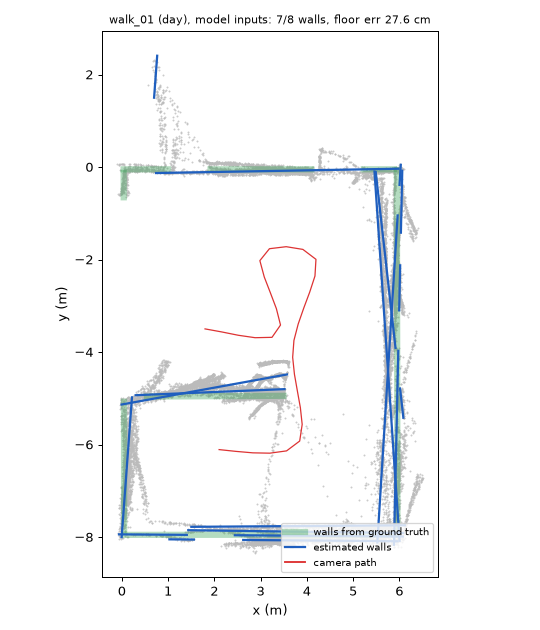

# Room layout vs ground truth: `model` inputs

**Floor height error 11.8 cm · tilt 1.55° · eye height 1.59 m (rig: 1.60) · walls found 87 % · wall angle error 3.5° · wall offset 7.7 cm · support relations agree 75 %**

| Walk | Lighting | Floor err (cm) | Tilt (°) | Eye height (m) | Walls found | Wall offset (cm) |
|---|---|---|---|---|---|---|
| walk_01 | day | 27.6 | 2.01 | 1.32 | 7/8 | 4.6 |
| walk_02 | overcast | 16.7 | 2.48 | 1.77 | 5/6 | 6.8 |
| walk_03 | evening | 10.4 | 1.21 | 1.50 | 4/4 | 6.1 |
| walk_04 | night | 6.7 | 0.53 | 1.53 | 5/5 | 11.0 |
| walk_05 | day | 4.2 | 0.73 | 1.56 | 6/6 | 8.0 |
| walk_06 | overcast | 7.6 | 1.36 | 1.68 | 3/4 | 5.4 |
| walk_07 | evening | 10.7 | 1.93 | 1.71 | 5/7 | 12.5 |
| walk_08 | night | 7.8 | 1.47 | 1.52 | 6/8 | 4.0 |
| walk_09 | day | 6.7 | 0.67 | 1.53 | 6/6 | 9.3 |
| walk_10 | overcast | 20.0 | 3.07 | 1.80 | 6/7 | 9.2 |

Support relations in `walk_01` (scene graph from GT inputs):

- tv#1: floor
- plant#2: floor
- table#3: floor
- chair#4: floor
- shelf#5: floor
- chair#6: floor
- shelf#7: floor
- lamp#8: on shelf#7
- plant#9: floor
- table#10: free
- sign#11: wall
- stove#12: floor
- sign#13: wall
- counter#14: floor
- sink#15: on counter#14

