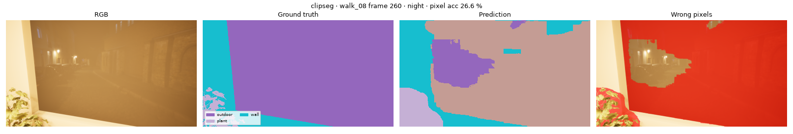
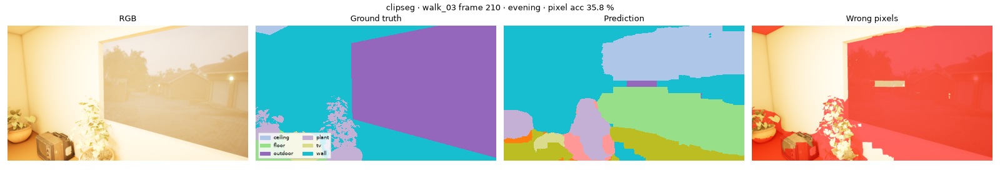
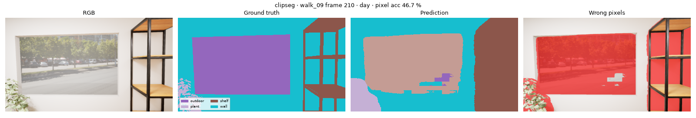
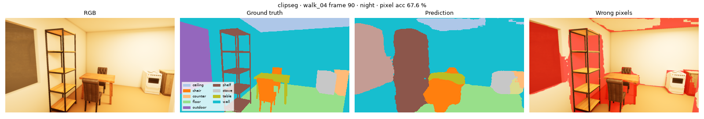

# Segmentation benchmark: `clipseg`

CIDAS/clipseg-rd64-refined · FP16 on cuda · every 10th frame · scored classes: 15 (door, window excluded)

**Speed:** 79.73 ms/frame median, 88.17 ms p95 (model forward at (352, 352))

| Split | mIoU (%) ↑ | Pixel acc (%) ↑ |
|---|---|---|
| **all** | 41.5 | 87.2 |
| day | 43.6 | 88.2 |
| overcast | 45.5 | 89.5 |
| evening | 35.7 | 85.4 |
| night | 40.9 | 83.9 |

| Class | IoU (%) ↑ | Most confused with |
|---|---|---|
| sign | 3.4 | wall (74 %) |
| tv | 13.4 | stove (58 %) |
| counter | 14.1 | shelf (55 %) |
| outdoor | 19.8 | sign (28 %) |
| lamp | 19.9 | wall (44 %) |
| sink | 29.1 | counter (11 %) |
| chair | 29.3 | shelf (3 %) |
| sofa | 35.1 | chair (62 %) |
| stove | 43.1 | counter (13 %) |
| table | 51.1 | chair (14 %) |
| shelf | 52.0 | wall (15 %) |
| plant | 55.9 | wall (5 %) |
| floor | 81.2 | table (5 %) |
| ceiling | 84.9 | wall (9 %) |
| wall | 90.3 | shelf (3 %) |

## Worst frames

