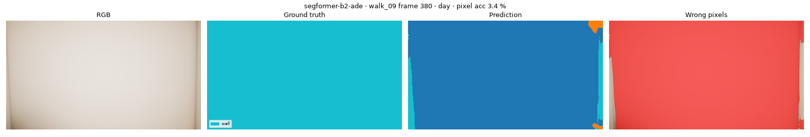
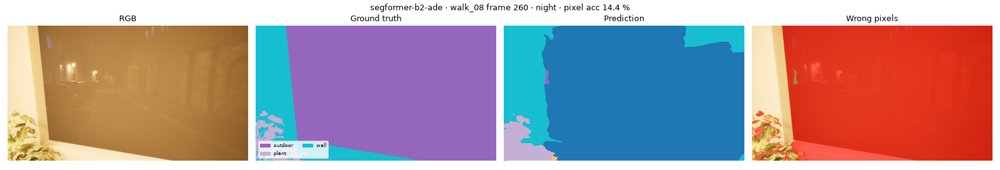
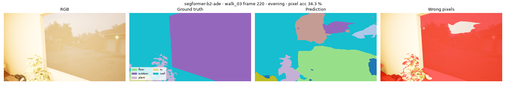
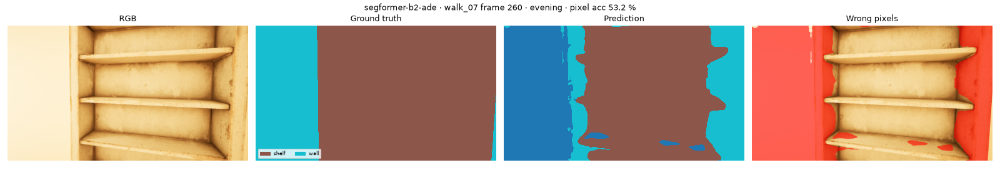

# Segmentation benchmark: `segformer-b2-ade`

nvidia/segformer-b2-finetuned-ade-512-512 · FP16 on cuda · every 10th frame · scored classes: 15 (door, window excluded)

**Speed:** 32.22 ms/frame median, 39.30 ms p95 (model forward at (512, 512))

| Split | mIoU (%) ↑ | Pixel acc (%) ↑ |
|---|---|---|
| **all** | 42.7 | 88.4 |
| day | 43.5 | 88.7 |
| overcast | 44.1 | 90.3 |
| evening | 35.3 | 85.8 |
| night | 43.7 | 87.6 |

| Class | IoU (%) ↑ | Most confused with |
|---|---|---|
| sink | 0.4 | other (48 %) |
| counter | 1.4 | shelf (61 %) |
| sign | 3.4 | wall (64 %) |
| lamp | 8.5 | wall (72 %) |
| sofa | 12.2 | chair (84 %) |
| outdoor | 23.8 | sign (41 %) |
| tv | 28.7 | other (25 %) |
| chair | 33.8 | table (5 %) |
| shelf | 48.2 | wall (17 %) |
| table | 62.2 | chair (8 %) |
| plant | 67.5 | wall (9 %) |
| stove | 72.3 | wall (10 %) |
| floor | 87.8 | wall (4 %) |
| wall | 93.2 | shelf (2 %) |
| ceiling | 96.5 | wall (2 %) |

## Worst frames

