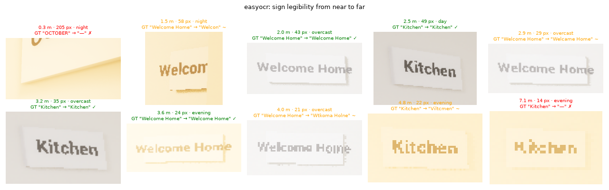

# Scene-text benchmark: `easyocr`

Four wall signs, every 5th frame, sign visible if ≥ 200 px

**Speed:** 110 ms/frame median (detection + recognition, full frame)

**Overall:** 331 sign views · detected 87.3 % · read exactly 38.4 % · CER 0.31

| Distance | Signs | Detected (%) ↑ | Read exactly (%) ↑ | CER ↓ |
|---|---|---|---|---|
| 0-1 m | 12 | 75.0 | 41.7 | 0.49 |
| 1-2 m | 64 | 87.5 | 45.3 | 0.29 |
| 2-3 m | 80 | 81.2 | 53.8 | 0.24 |
| >3 m | 175 | 90.9 | 28.6 | 0.34 |

| Sign height on screen | Signs | Detected (%) ↑ | Read exactly (%) ↑ | CER ↓ |
|---|---|---|---|---|
| 0-20 px | 40 | 85.0 | 2.5 | 0.62 |
| 20-40 px | 179 | 92.7 | 42.5 | 0.22 |
| 40-80 px | 78 | 76.9 | 47.4 | 0.33 |
| >80 px | 34 | 85.3 | 38.2 | 0.39 |

| Lighting | Signs | Detected (%) ↑ | Read exactly (%) ↑ | CER ↓ |
|---|---|---|---|---|
| day | 75 | 89.3 | 48.0 | 0.25 |
| overcast | 126 | 96.0 | 40.5 | 0.24 |
| evening | 83 | 78.3 | 32.5 | 0.39 |
| night | 47 | 76.6 | 27.7 | 0.45 |

| Sign | Signs | Detected (%) ↑ | Read exactly (%) ↑ | CER ↓ |
|---|---|---|---|---|
| Sign_02 "Kitchen" | 154 | 81.2 | 42.9 | 0.34 |
| Sign_03 "Welcome Home" | 122 | 99.2 | 38.5 | 0.20 |
| Sign_04 "OCTOBER" | 55 | 78.2 | 25.5 | 0.48 |

